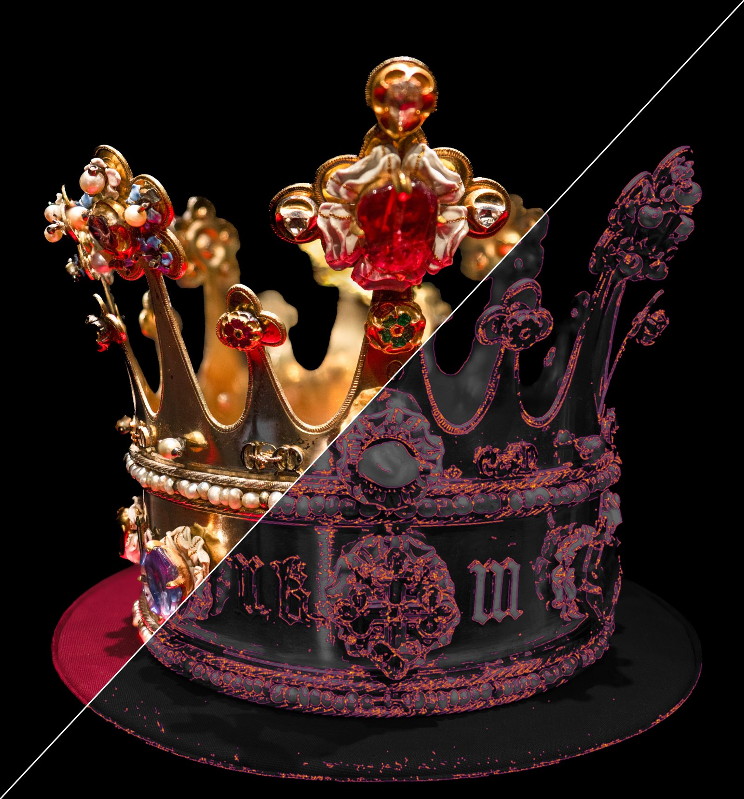
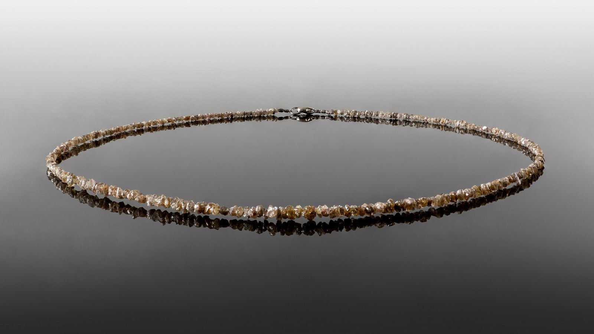
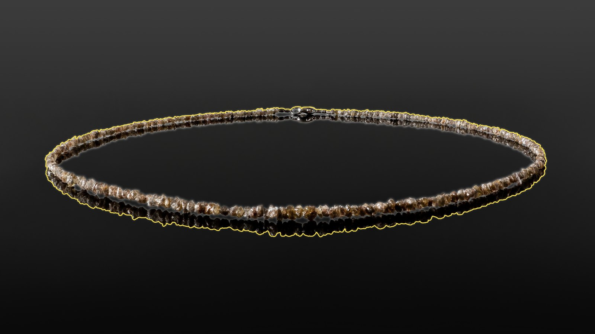
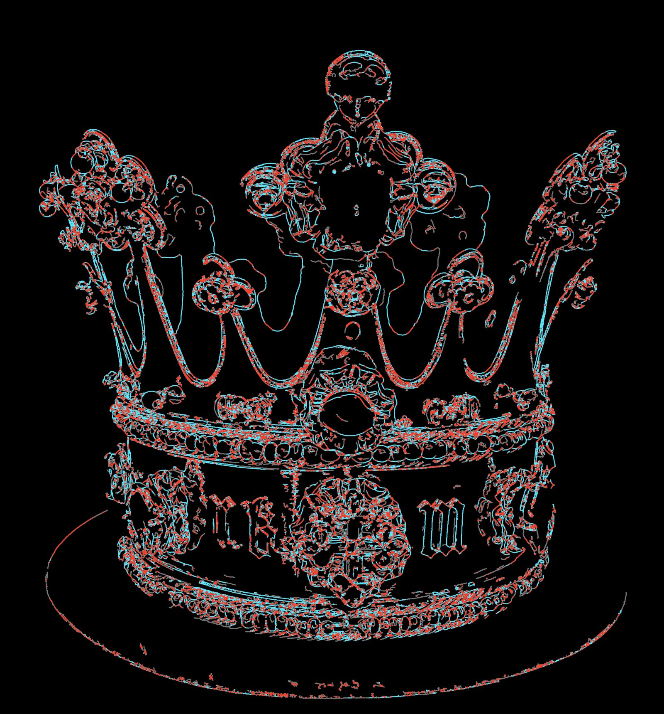
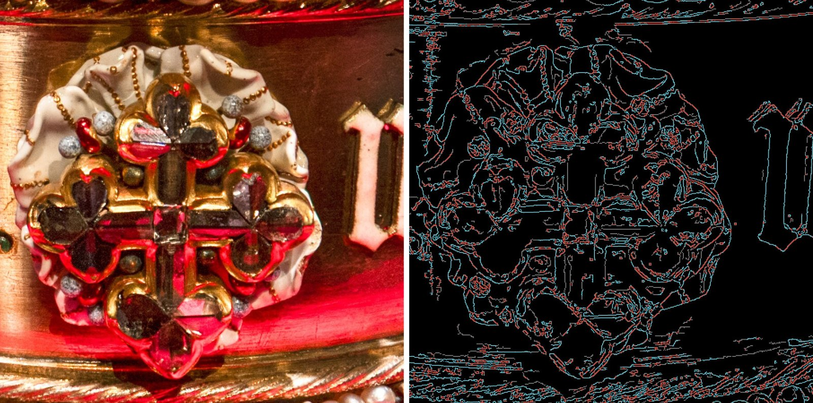
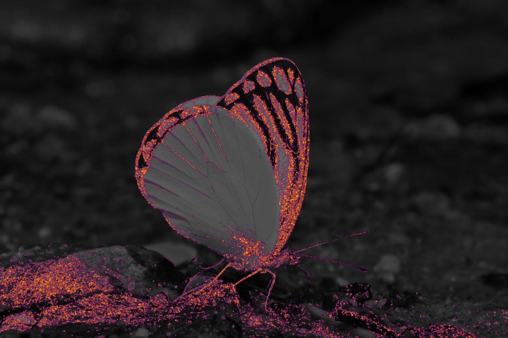
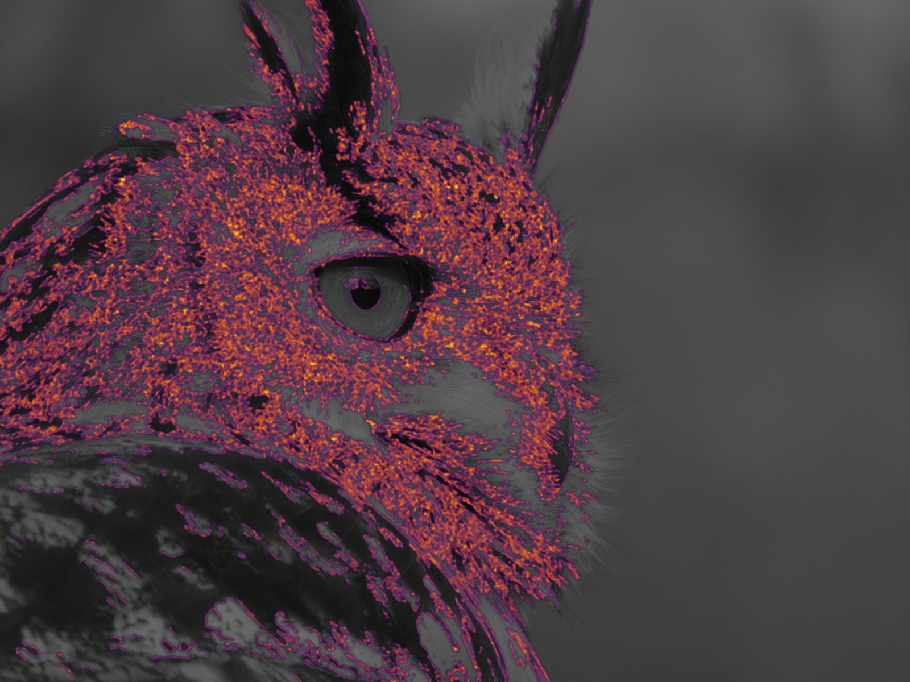

# ComfyUI-Happyin-Canny

**Where does the detail in this picture actually live?** One ComfyUI node that answers it with nothing but OpenCV: no models, no weights, no settings.



The idea in one line: **a coarse map decides where to look; the details themselves are taken from full resolution.**

Detail gives itself away. Gemstone facets, feathers, engraving and fabric weave are dense with edges, while smooth backgrounds are not. So the node finds where edges are crowded, turns that into a heat map, and then looks for fine edges only there.

## What it is good for

- **Returning detail after denoising, upscaling or diffusion.** The mask says *where* to bring the original back, the full-resolution edges say *what* to bring back. Backgrounds stay clean, facets stay sharp.
- **Mining training crops.** Cut crops where the map is hot and stop spending training on empty sky.
- **Loss weighting.** An error on a hot pixel costs more than an error on a flat wall.

## How it works

1. **Coarse pass.** Large images are downscaled (to 70% above 1500 px, 1/2 above 4000 px, 1/3 above 5000 px). Canny 100/200 runs on the small copy, so only confident edges survive; fragments under 5 px are dropped.
2. **Heat map.** Those edges are scaled back up and blurred with a 15×15 Gaussian. Where lines are dense they merge into a hot patch; a lone line leaves only a faint trace. Normalised to 0–255.
3. **Detail mask.** Everything warmer than 30, cleaned with a 3×3 opening, islands under 500 px removed.
4. **Second pass.** Canny 100/200 again, now on the full-resolution image and only inside the mask.
5. **Third pass.** Where the map is warmer than 150, Canny drops to 5/20 to catch texture, fibres and fine engraving. Outside the hot zones those thresholds would just be noise, so they are never used there.
6. All passes are merged into one edge map.

| Necklace of rough diamonds | Its detail mask: 7% of the frame |
|---|---|
|  |  |





## Does the mask really hold the detail?

Seven free Wikimedia Commons photos, run through the node unchanged. For reference, a plain full-frame Canny 100/200 was counted, and we checked what share of its edges falls inside the mask.

| Photo | Frame inside the mask | Strong edges inside |
|---|---|---|
| Necklace of rough diamonds | 7.0% | 97.7% |
| Crown of Margaret of York | 17.9% | 97.9% |
| Eurasian eagle-owl | 28.7% | 97.3% |
| Butterfly *Delias agostina* | 12.6% | 94.8% |
| Clock movement | 20.4% | 93.4% |
| Wells Cathedral, west front | 39.3% | 89.1% |
| Portrait of an elderly woman | 6.9% | 73.9% |

The portrait marks the limit: fine wrinkles give sparse single lines, they never build up density on the map, and part of the skin stays outside. For skin, edge density is not the same as importance.

| | |
|---|---|
|  |  |

## Installation

**ComfyUI-Manager:** *Install via Git URL* → `https://github.com/AnastasiyaW/ComfyUI-Happyin-Canny`

**Manually:**

```bash
cd ComfyUI/custom_nodes
git clone https://github.com/AnastasiyaW/ComfyUI-Happyin-Canny
pip install -r ComfyUI-Happyin-Canny/requirements.txt
```

Restart ComfyUI. The node is **image → processing → Happyin → Happyin Canny**. It needs only `opencv` and `numpy`; `torch` comes with ComfyUI.

Check the install from the node folder: `python tests/test_node.py` prints `PASS`.

## Inputs and outputs

Input: `image` (batches are supported). There are no parameters; every threshold above is fixed in the code.

| Output | What it is |
|---|---|
| `combined_edges_final` | all three passes merged |
| `detailed_edges_pass2` | full-resolution Canny 100/200 inside the detail mask |
| `extra_detailed_edges_pass3` | Canny 5/20 inside the hottest zones |
| `cleaned_first_pass_edges` | the coarse pass, clipped to the mask |
| `detail_filter_mask` | white where the detail is |
| `gradient_heatmap` | edge-density heat map, JET colours |

The node key is `Happyin_Canny`, the same as in the Happyin node pack, so existing workflows load unchanged.

## Licence

Code: MIT. Example images in `docs/` are derived from Wikimedia Commons photographs and keep their own licences: see [docs/CREDITS.md](docs/CREDITS.md).
