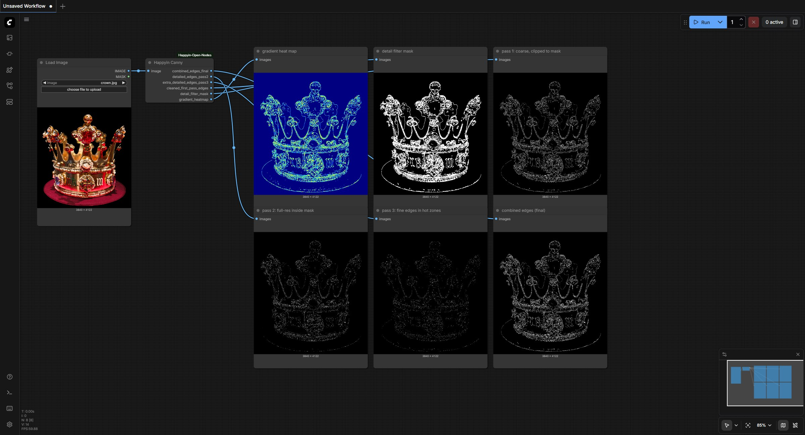
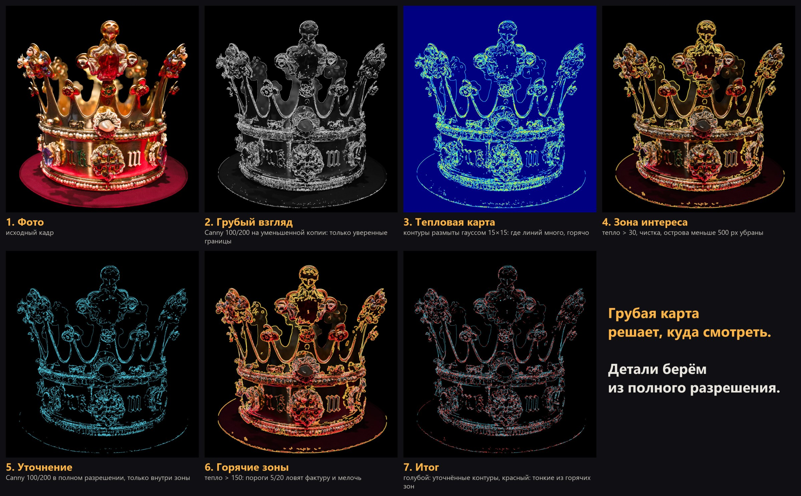
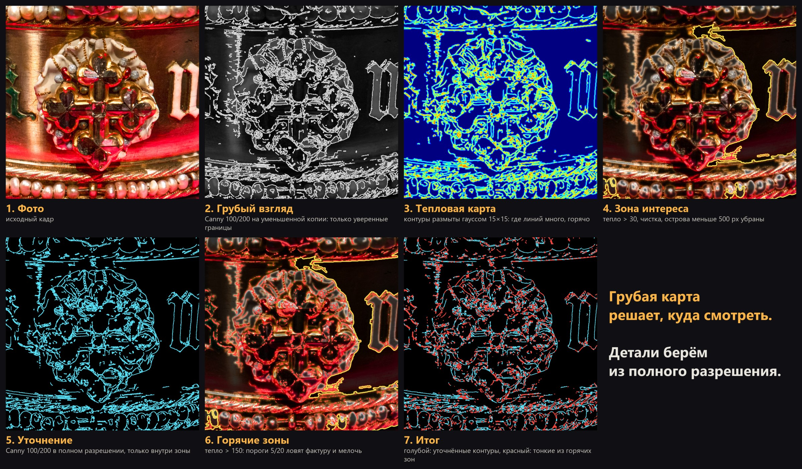
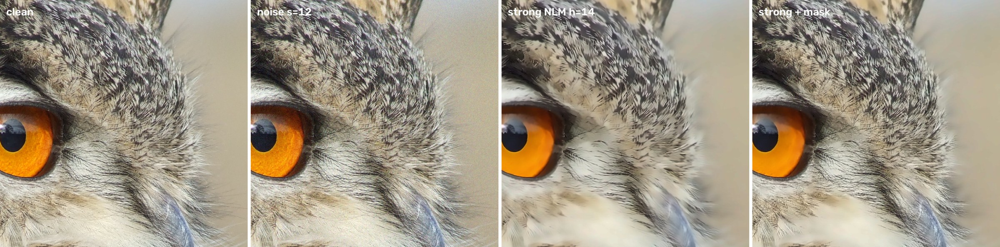
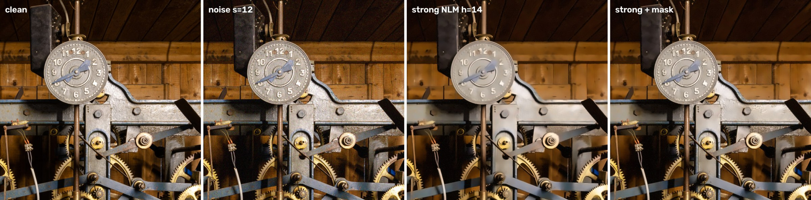
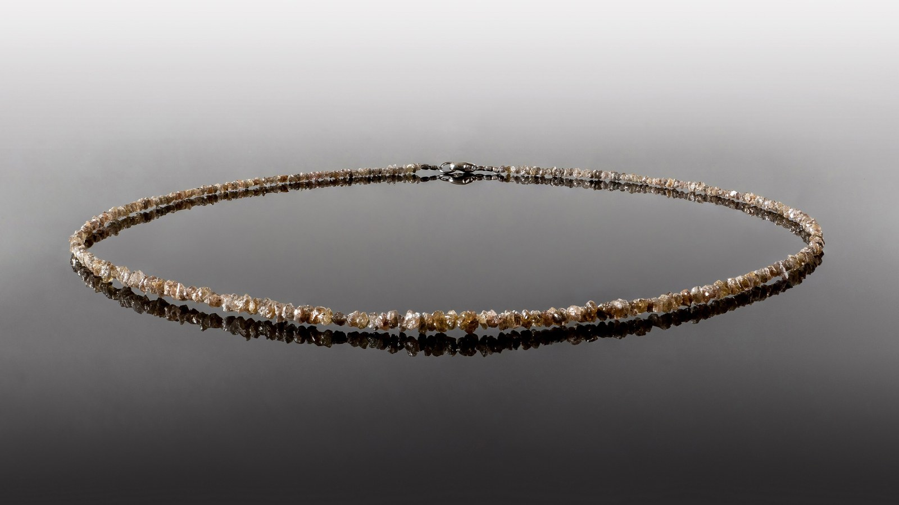
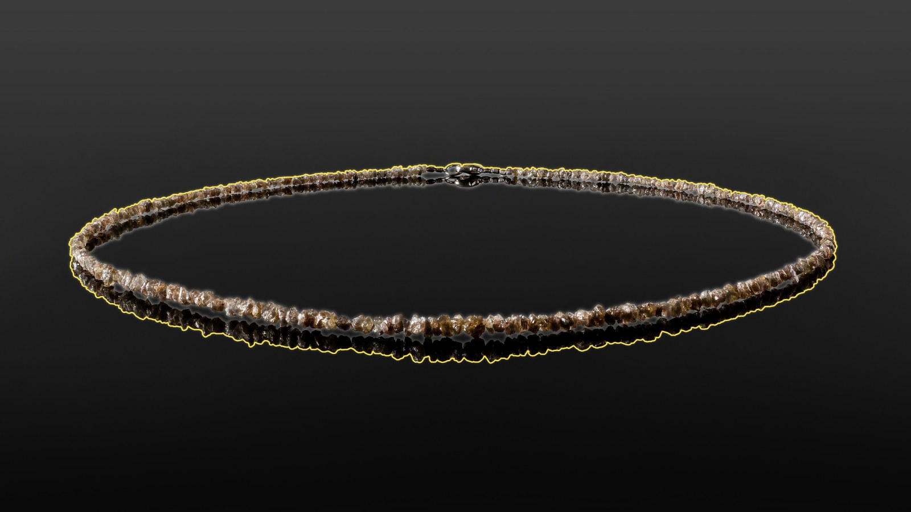
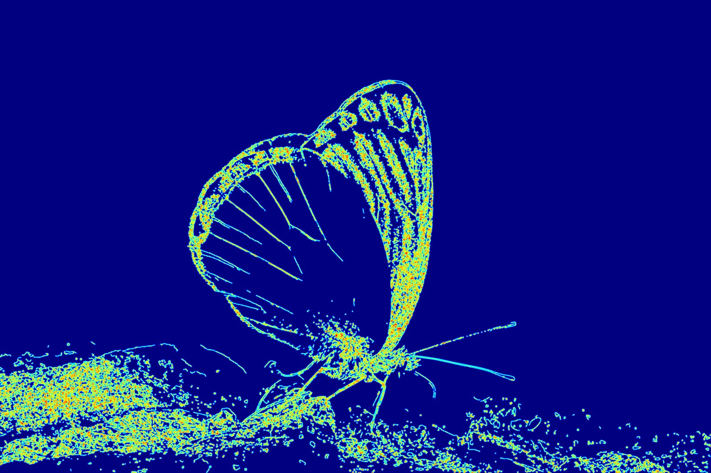

# ComfyUI-Happyin-Open-Nodes

The open part of the Happyin ComfyUI node set. It starts with one node and will grow; every node here installs with nothing heavier than OpenCV and NumPy.

| Node | What it does |
|---|---|
| **Happyin Canny** | Finds where the detail in an image lives and extracts it at full resolution. Use it to protect detail during denoising, to return detail after diffusion or upscaling, and to pick training crops. |



## Installation

**ComfyUI-Manager:** *Install via Git URL* → `https://github.com/AnastasiyaW/ComfyUI-Happyin-Open-Nodes`

**Manually:**

```bash
cd ComfyUI/custom_nodes
git clone https://github.com/AnastasiyaW/ComfyUI-Happyin-Open-Nodes
pip install -r ComfyUI-Happyin-Open-Nodes/requirements.txt
```

Restart ComfyUI. The nodes appear under **image → processing → Happyin**. `torch` comes with ComfyUI.

Check the install from the pack folder: `python tests/test_happyin_canny.py` prints `PASS`.

### Tested on

Each run started a real ComfyUI headless with only this pack in `custom_nodes`, queued LoadImage → Happyin Canny → six SaveImage nodes, and checked all six files.

| ComfyUI | Python | torch | OpenCV | Result |
|---|---|---|---|---|
| 0.16.4 | 3.13.11 | 2.10.0+cu130 (CPU run) | 4.13.0 | PASS |
| 0.13.0 | 3.13.11 | 2.10.0+cu130 (CPU run) | 4.13.0 | PASS |
| 0.3.75 | 3.13.11 | 2.10.0+cu130 (CPU run) | 4.13.0 | PASS |
| unit test, no ComfyUI | 3.14 | 2.13.0+cpu | 5.0.0 | PASS |
| unit test, no ComfyUI | 3.13.9 | 2.10.0+cu130 | 4.12.0 | PASS |

The node accepts any `IMAGE` tensor ComfyUI produces: RGB, RGBA or one channel, fp32/fp16/bf16, on CPU or GPU, values outside 0–1 (clipped), and batches.

---

## Happyin Canny

**A coarse map decides where to look; the details themselves are taken from full resolution.**

Detail gives itself away. Gemstone facets, feathers, engraving and fabric weave are dense with edges, while smooth backgrounds are not. So the node finds where edges are crowded, turns that into a heat map and a clean mask, and then looks for fine edges only there.



1. **Coarse look.** Large images are downscaled (to 70% above 1500 px, 1/2 above 4000 px, 1/3 above 5000 px). Canny 100/200 runs on the small copy, so only confident edges survive; fragments under 5 px are dropped.
2. **Heat map.** Those edges are scaled back up and blurred with a 15×15 Gaussian. Where lines are dense they merge into a hot patch. Normalised to 0–255.
3. **Zone of interest.** Everything warmer than 30, cleaned with a 3×3 opening, islands under 500 px removed.
4. **Refine.** Canny 100/200 again on the full-resolution image, only inside the zone.
5. **Hot zones.** Where the map is warmer than 150, Canny drops to 5/20 to catch texture, fibres and fine engraving. Outside the hot zones those thresholds would just be noise, so they are never used there.
6. All passes are merged into one edge map.



### Main use: denoising without losing detail

Denoisers smear detail. A strong denoise cleans the background and takes feathers, engraving and fibres with the noise; a light one keeps the detail and the noise. With the mask you get both: build it from the **noisy** frame, use the light denoise inside and the strong one outside, with a soft edge.

Five Wikimedia Commons photos, Gaussian noise σ = 12, OpenCV non-local means (strong h = 14, light h = 4). PSNR in dB against the clean original; "texture" is the 15% most textured pixels and "flat" the 50% flattest, both taken from the clean frame, so they do not depend on the mask.

| Photo | Texture: strong | light | **strong + mask** | Flat: strong | **strong + mask** |
|---|---|---|---|---|---|
| Crown | 25.91 | 28.00 | **29.26** | 34.97 | **35.01** |
| Clock movement | 28.34 | 28.10 | **30.05** | 34.02 | **34.11** |
| Eagle-owl | 26.83 | 29.14 | **29.99** | 39.45 | **39.45** |
| Eagle-owl, second photo | 24.86 | 28.04 | **28.85** | 35.20 | **35.27** |
| Butterfly | 25.67 | 27.50 | **28.82** | 39.73 | **39.72** |

With the mask, texture beats both the strong and the light denoise on all five photos, and the background stays as clean as with the strong one.





### How it compares with other detail maps

What matters for denoising is which map covers the places where a strong denoise loses detail. The loss map is the change in the Laplacian before and after the strong denoise; each method keeps its hottest pixels at the same area as Happyin's mask (about 22% of the frame). Mean over the five photos:

| Map | Share of the loss covered |
|---|---|
| Sobel gradient magnitude | 46.2% |
| Local Laplacian variance | 46.4% |
| Local standard deviation | 40.5% |
| **Happyin Canny mask** | 44.9% |
| A random region of the same area | ≈22% (expected value: share equals area; not measured) |

As a raw region map it is on a par with Sobel and the Laplacian, which are slightly ahead. The difference is what you get out of the node: a clean, ready-to-use mask with no threshold to tune, full-resolution edges inside it, and a separate fine pass in the hottest zones. Sobel and the Laplacian give a raw map and leave the rest to you.

### Other uses

- **Returning detail after diffusion or upscaling.** The mask says *where* to bring the original back, the full-resolution edges say *what*.
- **Mining training crops.** Cut crops where the map is hot and stop spending training on empty sky.
- **Loss weighting.** An error on a hot pixel costs more than an error on a flat wall.

**Limit:** edge density is not the same as importance. Fine wrinkles on skin give sparse single lines that never build up density, so part of the skin stays outside the mask.

### Inputs and outputs

Input: `image`. There are no parameters; every threshold above is fixed in the code.

| Output | What it is |
|---|---|
| `combined_edges_final` | all passes merged |
| `detailed_edges_pass2` | full-resolution Canny 100/200 inside the detail mask |
| `extra_detailed_edges_pass3` | Canny 5/20 inside the hottest zones |
| `cleaned_first_pass_edges` | the coarse pass, clipped to the mask |
| `detail_filter_mask` | white where the detail is |
| `gradient_heatmap` | edge-density heat map, JET colours |

The node key is `Happyin_Canny`, the same as in the private Happyin pack, so existing workflows load unchanged.

| | |
|---|---|
|  |  |
|  |  |

## Adding a node to the pack

Put the module in `nodes/`, add one line to each mapping in `__init__.py`, a test in `tests/`, and a section here.

## Licence

Code: MIT. Example images in `docs/` are derived from Wikimedia Commons photographs and keep their own licences: see [docs/happyin-canny/CREDITS.md](docs/happyin-canny/CREDITS.md).
